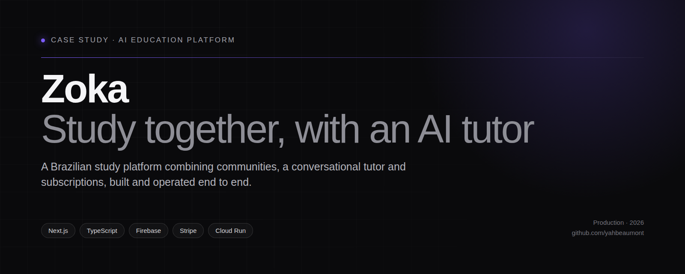
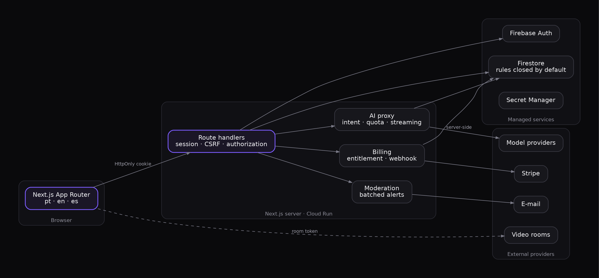
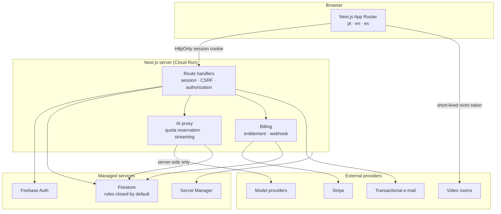
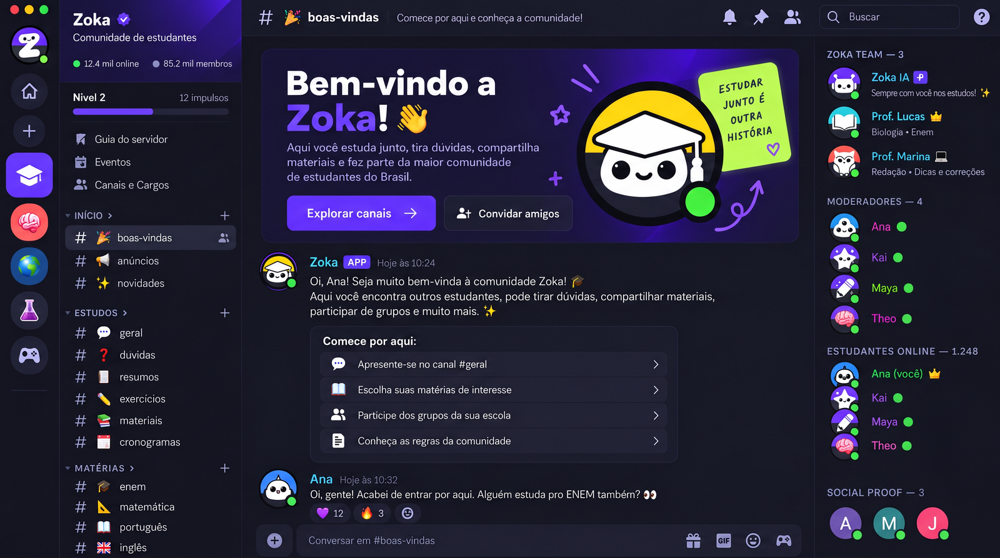

# Zoka
[English](README.md) · [Português](README.pt-BR.md)

An AI study platform for Brazilian students: communities, a conversational tutor and paid plans, built and operated end to end.



> **What this repository is.** A technical case study of a real product in production at [zoka.chat](https://zoka.chat). It documents the architecture, the engineering decisions and the parts of the system that were hard to get right. It is **not** the product source code, and it is not open source. The commercial layer, the data model and the operational configuration are deliberately omitted.

---

## Overview

Zoka is a subscription platform where students study together. It combines Discord-like communities (groups, channels, direct messages, moderation) with a conversational tutor that answers questions, searches the web when the question requires current information, and keeps usage inside plan quotas.

The product runs on Next.js with Firebase for identity and persistence, Stripe for billing, and a separate AI service for inference. It has been live since 2026, serving Portuguese, English and Spanish interfaces from a single codebase.

I designed the product, the architecture and the implementation, and I operate it. This repository is my account of how it works and why it is built this way.

## The problem

Brazilian students study in groups, on WhatsApp, with PDFs scattered across phones and no reliable place to ask a question at 11 pm. Existing study apps are either content libraries (video plus exercises) or generic chat tools with no academic context.

Three constraints shaped the design:

1. **Trust.** The audience includes minors. Data minimisation, consent and moderation are product requirements, not compliance paperwork added later.
2. **Cost control.** A conversational tutor with no quota is a business that loses money per active user. Every AI interaction needs a server-side reservation, not a client-side counter.
3. **Community gravity.** Groups only work if membership, permissions and moderation are real. A chat box with no roles is abandoned in a week.

## What the product does

**Communities.** Public and private groups with text channels, direct messages, membership approval, owner and moderator roles, per-channel posting rules, a school hub created from an e-mail domain verification, and a student directory that never exposes e-mail or tax ID.

**Tutoring.** A conversational tutor with subject context, streaming responses, attachment handling, prompt-injection filtering, intent classification before generation, optional web search with cited sources, and quotas enforced on the server.

**Plans and billing.** Free, Pro and Family subscriptions through Stripe Checkout, plus a separate one-off sponsorship flow that issues redeemable annual vouchers. Entitlements are resolved server-side from subscription state, never from a client claim.

**Focus rooms.** Small group audio and video rooms with a participant cap, recording disabled by design, and a discreet exit path for a student who needs to leave.

**Creator programme.** A separate AI tier for content creators, with its own provider contract, error taxonomy and quota accounting.

**Operations.** Admin surfaces for manual grants, moderation alerts, revenue reporting, and a QA path that runs entirely against emulators and mocks.

## Architecture




| Component | Responsibility |
|---|---|
| Next.js App Router | Localised UI, server components, route handlers |
| Session layer | Firebase ID token exchange, HttpOnly cookie, CSRF, custom claims |
| Community service | Groups, channels, membership, moderation, read models |
| AI proxy | Intent classification, quota reservation and settlement, streaming, sanitisation |
| Billing service | Checkout, webhook verification, entitlement resolution, vouchers |
| Firestore | Persistence, with rules closed by default and server-side authorization |
| Cloud Run | Runtime for the Next.js server, with secrets bound by reference |

A request that uses the tutor goes through five steps: the browser calls the Zoka API with its session cookie; the route handler validates session, CSRF and membership; the AI proxy classifies the intent and reserves quota in a transaction; the provider stream is opened and proxied to the client as server-sent events; on completion the reservation is settled or rolled back, and the message is persisted.

## Engineering highlights

### Quotas that survive retries, failures and concurrency

The naive quota is a counter incremented before the model call. It breaks in three ways: a failed generation still consumes the quota, two parallel requests both pass the check, and a client that reconnects consumes twice.

Zoka separates **reservation** from **settlement**. The proxy reserves a slot inside a Firestore transaction that also checks the hourly anti-abuse window, then opens the stream. If generation fails before the first token, the reservation is rolled back and the daily quota is restored; the attempt still counts against the hourly window, because the cost of the attempt is real. Settlement is idempotent, keyed by message, so a retried request cannot settle twice.

The trade-off is a short window where a reservation exists without a message. That is intentional: an orphaned reservation expires and is released, and the alternative, optimistic counting, is what produces either lost revenue or blocked users.

### Entitlement resolved on the server, from state, not from claims

Plan checks cannot trust a cookie. Zoka resolves entitlement from the current subscription record on every protected operation, then synchronises Firebase custom claims (`role`, `plan`) as a cache for the client. When the claim and the record disagree, the record wins.

The sponsorship flow made this concrete. A one-off payment issues a voucher that, when redeemed, creates an expiring grant with a distinct source. It is not modelled as a fake subscription, so it cannot inherit renewal behaviour or leak into revenue reporting. Family plans resolve to a single titular with up to three dependants, and the entitlement check knows the difference between the titular and a member.

### Authentication for people who log in with a tax ID

Brazilian students expect to log in with CPF. Storing a CPF in plaintext is not acceptable, and hashing alone breaks the ability to find the account server-side.

Zoka stores two derived values: a salted SHA-256 hash for equality checks and an HMAC for server-side lookup, with the HMAC key never exposed to the client. The login form accepts e-mail or CPF; both resolve to the same account without revealing which one exists.

The Google flow adds a harder case. When a verified Google identity matches an existing e-mail under a different UID, the server returns a conflict instead of merging accounts. The client keeps the pending OAuth credential in memory only, authenticates the person with the existing password, links the credential to that same user, and then creates the session. No duplicate profile, no silent merge, no e-mail disclosure.

### Moderation that does not read everything in real time

Focus room chat is analysed in batches of ten messages by a server-side queue. A positive result writes a restricted alert record and sends only the flagged excerpt to an authorised recipient. The student interface never reveals that analysis happened, and the family panel shows aggregate safety status, never message text.

This is a deliberate compromise: batching reduces cost and latency, at the price of not being instantaneous. It is a product control, not a guarantee of safety, and the documentation says so.

### Three locales without three codebases

The interface is localised with route-level locale segments and message catalogues, including the legal pages and the transactional e-mails. Dates, currency and the tutor's fallback messages follow the locale. The content layer (blog, help, legal) is generated from typed sources so that a missing translation fails the build instead of shipping a blank page.

## Tech stack

| Layer | Choice | Why |
|---|---|---|
| Application | Next.js App Router, React, TypeScript | Server components and route handlers in one runtime |
| Styling | Tailwind CSS | Design tokens close to the markup, no runtime CSS |
| Identity | Firebase Auth | E-mail, CPF and Google in one identity surface |
| Persistence | Cloud Firestore, São Paulo region | Managed, regional, with rules as a second boundary |
| Server runtime | Cloud Run | Scales to zero, secrets bound by reference |
| AI | Provider-agnostic proxy, SSE streaming | Model choice stays an operational decision |
| Billing | Stripe Checkout and webhooks | Hosted checkout, no card data in the product |
| E-mail | Transactional API | Verification, OTP and moderation alerts |
| Video | Managed room SDK | Small rooms, recording disabled |
| Quality | Node test runner, TypeScript, emulator suites | Tests that run without touching production |

## By the numbers

| Metric | Value |
|---|---|
| Tracked files | 737 |
| Lines of code | ~75,400 |
| TypeScript files | 553 |
| API route handlers | 94 |
| Pages | 32 |
| Test files | 151 |
| Shared library modules | 155 |
| Commits | 139 |
| Locales | 3 (pt, en, es) |
| Runtime dependencies | 32 |

## Screenshots

The home surface of the product, captured from the running application. The names in the sidebar and in the message list belong to seeded demonstration accounts, not to real students.



## Security and privacy

Implemented: HttpOnly session cookie with CSRF protection; server-side authorization on every protected operation, duplicated behind Firestore rules that are closed by default; CPF stored only as hash and HMAC; Stripe webhook signature verification over the raw body with idempotent processing; quota and rate limiting on the server; analytics gated behind explicit consent, with anonymised paths and no identifiers; secrets bound from a managed secret store, never committed.

Not claimed: this repository does not assert legal compliance, certification or absolute security. Minors' data handling follows data minimisation and consent principles in the product, but the legal assessment sits outside the code. The tutor's filters reduce prompt-injection risk; they do not eliminate it.

## Scope of this repository

Published: architecture, decision records, the case study, security model, diagrams and three self-contained examples that illustrate techniques with generic names and fictional data.

Omitted on purpose: the product source code, the Firestore data model, pricing and quota constants, provider contracts, operational configuration, admin surfaces, customer data and the full test suite. Where a detail would let someone rebuild the commercial product, this repository describes the mechanism and stops.

## Repository map

```
.
├── README.md
├── README.pt-BR.md
├── docs/
│   ├── ARCHITECTURE.md
│   ├── CASE-STUDY.md
│   ├── DECISIONS.md
│   ├── SECURITY.md
│   └── pt-BR/
├── diagrams/
├── examples/
└── screenshots/
```

## Documentation

- [Architecture](docs/ARCHITECTURE.md)
- [Decisions](docs/DECISIONS.md)
- [Case study](docs/CASE-STUDY.md)
- [Security and privacy](docs/SECURITY.md)
- [Português](README.pt-BR.md)

## Author

**Hay Beaumont**, software architect and engineer. I build AI products from concept to operation: architecture, full-stack implementation, billing, infrastructure and the operational details that decide whether a product survives contact with users.

[github.com/yahbeaumont](https://github.com/yahbeaumont)
