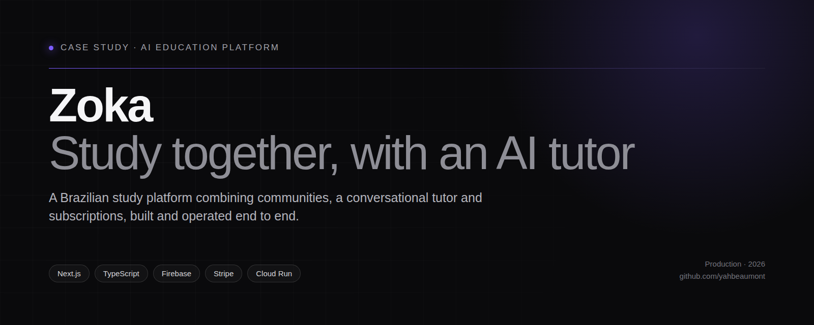
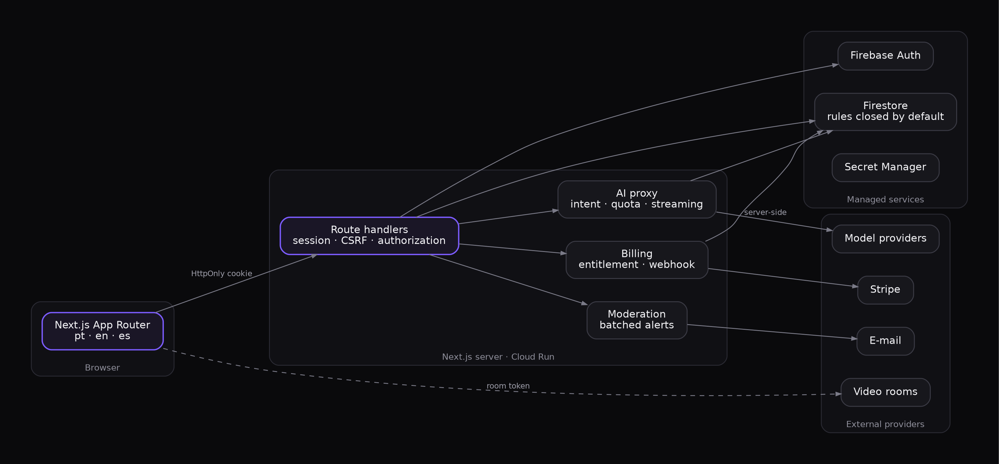
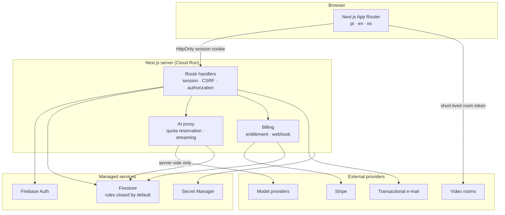
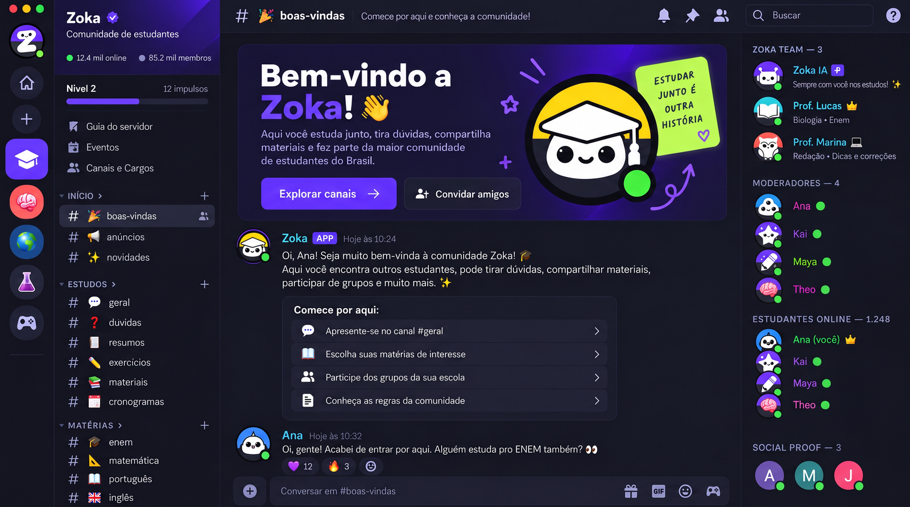

# Zoka
[English](README.md) · **Português**

Uma plataforma de estudos com IA para estudantes brasileiros: comunidades, um tutor conversacional e planos pagos, construída e operada de ponta a ponta.



> **O que este repositório é.** Um estudo de caso técnico de um produto real, em produção em [zoka.chat](https://zoka.chat). Aqui estão a arquitetura, as decisões de engenharia e as partes do sistema que deram trabalho para acertar. **Não** é o código-fonte do produto e não é open source. A camada comercial, o modelo de dados e a configuração operacional ficaram de fora de propósito.

---

## Visão geral

Zoka é uma plataforma por assinatura onde estudantes estudam juntos. Ela junta comunidades no estilo Discord (grupos, canais, mensagens diretas, moderação) com um tutor conversacional que responde perguntas, pesquisa na web quando a pergunta pede informação atual e mantém o uso dentro da cota do plano.

O produto roda em Next.js, com Firebase para identidade e persistência, Stripe para billing e um serviço de IA separado para inferência. Está no ar desde 2026 e serve as interfaces em português, inglês e espanhol a partir de um único código.

Eu desenhei o produto, a arquitetura e a implementação, e também opero tudo. Este repositório é o meu relato de como o sistema funciona e por que ele é assim.

## O problema

Estudante brasileiro já estuda em grupo, no WhatsApp, com PDF espalhado pelo celular e nenhum lugar confiável para tirar uma dúvida às 23h. Os apps de estudo que existem são bibliotecas de conteúdo (vídeo e exercício) ou chats genéricos, sem contexto acadêmico.

Três restrições moldaram o desenho:

1. **Confiança.** O público inclui menores. Minimizar dados, pedir consentimento e moderar conteúdo são requisitos de produto, não papelada de compliance que se resolve depois.
2. **Controle de custo.** Tutor conversacional sem cota é um negócio que perde dinheiro a cada usuário ativo. Toda interação de IA precisa de uma reserva no servidor, não de um contador no cliente.
3. **Comunidade como âncora.** Grupo só funciona quando associação, permissões e moderação são de verdade. Caixa de chat sem papéis é abandonada em uma semana.

## O que o produto faz

**Comunidades.** Grupos públicos e privados com canais de texto, mensagens diretas, aprovação de entrada, papéis de dono e moderador, regras de postagem por canal, um hub escolar criado a partir da verificação de domínio de e-mail e um diretório de estudantes que nunca mostra e-mail nem CPF.

**Tutoria.** Tutor conversacional com contexto da matéria, resposta em streaming, tratamento de anexos, filtro de prompt injection, classificação de intenção antes da geração, busca na web opcional com fontes citadas e cotas aplicadas no servidor.

**Planos e billing.** Assinaturas Free, Pro e Family pelo Stripe Checkout, mais um fluxo separado de patrocínio avulso que emite vouchers anuais resgatáveis. O servidor resolve o entitlement a partir do estado da assinatura, nunca a partir do que o cliente declara.

**Salas de foco.** Salas pequenas de áudio e vídeo, com limite de participantes, gravação desligada por decisão de projeto e uma saída discreta para quem precisa sair.

**Programa para criadores.** Um tier de IA separado para criadores de conteúdo, com contrato de provider, taxonomia de erros e contabilização de cota próprios.

**Operação.** Telas administrativas para concessões manuais, alertas de moderação e relatórios de receita, além de um caminho de QA que roda inteiro contra emuladores e mocks.

## Arquitetura




| Componente | Responsabilidade |
|---|---|
| Next.js App Router | UI localizada, server components, route handlers |
| Camada de sessão | Troca de ID token do Firebase, cookie HttpOnly, CSRF, custom claims |
| Serviço de comunidades | Grupos, canais, associação, moderação, read models |
| Proxy de IA | Classificação de intenção, reserva e liquidação de cota, streaming, sanitização |
| Serviço de billing | Checkout, verificação de webhook, resolução de entitlement, vouchers |
| Firestore | Persistência, com rules fechadas por padrão e autorização no servidor |
| Cloud Run | Runtime do servidor Next.js, com secrets vinculados por referência |

Uma pergunta ao tutor percorre cinco passos. O browser chama a API da Zoka com o cookie de sessão. O route handler valida sessão, CSRF e associação. O proxy de IA classifica a intenção e reserva cota dentro de uma transação. O stream do provider abre e os trechos da resposta chegam ao cliente como server-sent events. No fim, a reserva é liquidada ou desfeita e a mensagem fica gravada.

## Destaques de engenharia

### Cotas que aguentam retry, falha e concorrência

A cota ingênua é um contador que sobe antes da chamada ao modelo. Ela quebra de três jeitos: geração que falha continua consumindo cota, duas requisições paralelas passam pela verificação e o cliente que reconecta consome duas vezes.

Zoka separa **reserva** de **liquidação**. O proxy reserva uma vaga dentro de uma transação do Firestore, que também confere a janela horária de antiabuso; só então abre o stream. Se a geração falha antes do primeiro token, a reserva é desfeita e a cota diária volta. A tentativa, porém, continua contando na janela horária, porque o custo dela é real. A liquidação é idempotente e tem chave por mensagem, então requisição repetida não liquida duas vezes.

O preço é uma janela curta em que existe reserva sem mensagem. Isso é intencional. Reserva órfã expira e é liberada, e a alternativa, a contagem otimista, é justamente o que gera receita perdida ou usuário bloqueado.

### Entitlement vem do estado no servidor, não de claim

Verificação de plano não pode confiar em cookie. Em toda operação protegida, a Zoka resolve o entitlement no registro atual de assinatura e só depois sincroniza as custom claims do Firebase (`role`, `plan`) como cache para o cliente. Quando claim e registro divergem, vale o registro.

O fluxo de patrocínio deixou isso concreto. Um pagamento avulso emite um voucher. Ao ser resgatado, o voucher cria uma concessão com prazo e origem próprios. Como não é modelada como assinatura falsa, ela não herda a renovação nem contamina o relatório de receita. Plano Family resolve para um titular com até três dependentes, e a checagem de entitlement sabe distinguir titular de membro.

### Login com CPF

Estudante brasileiro espera entrar com CPF. Guardar CPF em texto puro não é aceitável, e só o hash também não resolve: quebra a busca da conta no servidor.

A Zoka guarda dois valores derivados: um hash SHA-256 com salt, para comparar igualdade, e um HMAC, para busca no servidor. A chave do HMAC nunca chega ao cliente. O formulário de login aceita e-mail ou CPF, e os dois chegam à mesma conta sem revelar qual deles existe.

O fluxo do Google traz um caso pior. Quando uma identidade Google verificada corresponde a um e-mail que já existe sob outro UID, o servidor devolve conflito em vez de fundir as contas. O cliente mantém a credencial OAuth pendente só em memória, autentica a pessoa com a senha que ela já tem, vincula a credencial àquele usuário e só então abre a sessão. Sem perfil duplicado, sem fusão silenciosa, sem dizer se o e-mail existe.

### Moderação que não lê tudo em tempo real

Uma fila no servidor analisa o chat das salas de foco em lotes de dez mensagens. Quando o resultado é positivo, ela grava um registro de alerta restrito e manda só o trecho sinalizado para um destinatário autorizado. A interface do estudante nunca dá sinal de que houve análise, e o painel da família mostra status agregado de segurança, nunca o texto das mensagens.

O compromisso é deliberado: lote reduz custo e latência ao preço de não ser instantâneo. É controle de produto, não garantia de segurança, e a documentação diz exatamente isso.

### Três locales sem três códigos

A interface usa segmentos de locale na rota e catálogos de mensagem, e isso vale também para as páginas legais e os e-mails transacionais. Data, moeda e mensagem de fallback do tutor seguem o locale. A camada de conteúdo (blog, ajuda, jurídico) nasce de fontes tipadas: tradução faltando quebra o build em vez de publicar página em branco.

## Stack técnico

| Camada | Escolha | Por quê |
|---|---|---|
| Aplicação | Next.js App Router, React, TypeScript | Server components e route handlers em um único runtime |
| Estilização | Tailwind CSS | Design tokens próximos do markup, sem CSS em runtime |
| Identidade | Firebase Auth | E-mail, CPF e Google em uma única superfície de identidade |
| Persistência | Cloud Firestore, região de São Paulo | Gerenciado, regional, com rules como segunda barreira |
| Runtime do servidor | Cloud Run | Escala até zero, secrets vinculados por referência |
| IA | Proxy agnóstico de provider, streaming SSE | A escolha de modelo continua uma decisão operacional |
| Billing | Stripe Checkout e webhooks | Checkout hospedado, nenhum dado de cartão no produto |
| E-mail | API transacional | Verificação, OTP e alertas de moderação |
| Vídeo | SDK de sala gerenciada | Salas pequenas, gravação desativada |
| Qualidade | Node test runner, TypeScript, suítes com emuladores | Testes que rodam sem tocar em produção |

## Em números

| Métrica | Valor |
|---|---|
| Arquivos rastreados | 737 |
| Linhas de código | ~75.400 |
| Arquivos TypeScript | 553 |
| Route handlers de API | 94 |
| Páginas | 32 |
| Arquivos de teste | 151 |
| Módulos de biblioteca compartilhados | 155 |
| Commits | 139 |
| Locales | 3 (pt, en, es) |
| Dependências de runtime | 32 |

## Capturas

A tela inicial do produto, capturada da aplicação rodando. Os nomes na barra lateral e na lista de mensagens são de contas de demonstração criadas por seed, não de estudantes reais.



## Segurança e privacidade

O que está implementado: cookie de sessão HttpOnly com proteção CSRF; autorização no servidor em toda operação protegida, repetida nas rules do Firestore, que ficam fechadas por padrão; CPF guardado só como hash e HMAC; verificação da assinatura do webhook do Stripe sobre o corpo bruto, com processamento idempotente; cota e rate limit no servidor; analytics liberado apenas com consentimento explícito, com caminhos anonimizados e sem identificadores; secrets lidos de um secret store gerenciado, nunca commitados.

O que não está afirmado: este repositório não declara conformidade legal, certificação nem segurança absoluta. O tratamento de dados de menores segue princípios de minimização e consentimento no produto, mas a avaliação jurídica fica fora do código. Os filtros do tutor reduzem o risco de prompt injection; não o eliminam.

## Escopo deste repositório

Publicado: arquitetura, registros de decisão, o estudo de caso, o modelo de segurança, diagramas e três exemplos autocontidos que ilustram técnicas com nomes genéricos e dados fictícios.

Omitido de propósito: o código-fonte do produto, o modelo de dados do Firestore, preços e constantes de cota, contratos de provider, configuração operacional, telas administrativas, dados de clientes e a suíte de testes completa. Onde um detalhe permitiria reconstruir o produto comercial, o repositório descreve o mecanismo e para.

## Mapa do repositório

```
.
├── README.md
├── README.pt-BR.md
├── docs/
│   ├── ARCHITECTURE.md
│   ├── CASE-STUDY.md
│   ├── DECISIONS.md
│   ├── SECURITY.md
│   └── pt-BR/
├── diagrams/
├── examples/
└── screenshots/
```

## Documentação

- [Arquitetura](docs/pt-BR/ARQUITETURA.md)
- [Decisões](docs/pt-BR/DECISOES.md)
- [Estudo de caso](docs/pt-BR/ESTUDO-DE-CASO.md)
- [Segurança e privacidade](docs/pt-BR/SEGURANCA.md)
- [English](README.md)

## Autor

**Hay Beaumont**, arquiteto de software e engenheiro. Construo produtos de IA do conceito à operação: arquitetura, implementação full-stack, billing, infraestrutura e os detalhes operacionais que decidem se um produto sobrevive ao contato com os usuários.

[github.com/yahbeaumont](https://github.com/yahbeaumont)
