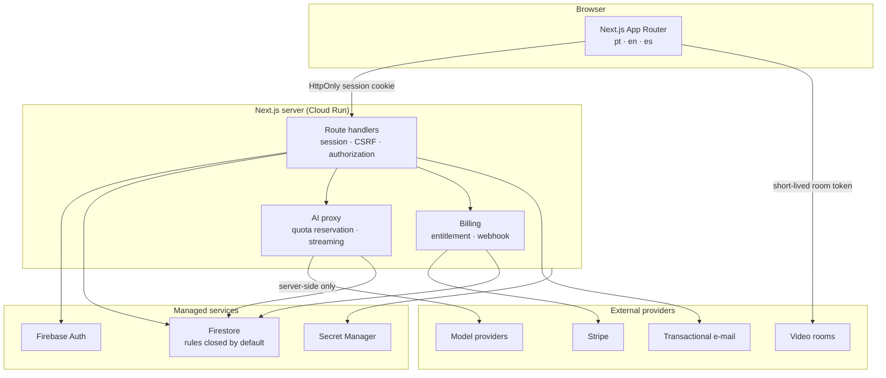

# Zoka
[English](README.md) · **Português**

Uma plataforma de estudos com IA para estudantes brasileiros: comunidades, um tutor conversacional e planos pagos, construída e operada de ponta a ponta.


> **O que este repositório é.** Um estudo de caso técnico de um produto real em produção em [zoka.chat](https://zoka.chat). Ele documenta a arquitetura, as decisões de engenharia e as partes do sistema que foram difíceis de acertar. **Não** é o código-fonte do produto e não é open source. A camada comercial, o modelo de dados e a configuração operacional foram deliberadamente omitidos.

---

## Visão geral

Zoka é uma plataforma por assinatura onde estudantes estudam juntos. Ela combina comunidades no estilo Discord (grupos, canais, mensagens diretas, moderação) com um tutor conversacional que responde perguntas, busca na web quando a pergunta exige informação atual e mantém o uso dentro das cotas do plano.

O produto roda em Next.js, com Firebase para identidade e persistência, Stripe para billing e um serviço de IA separado para inferência. Está no ar desde 2026, com interfaces em português, inglês e espanhol a partir de um único código-base.

Eu projetei o produto, a arquitetura e a implementação, e eu o opero. Este repositório é o meu relato de como ele funciona e por que foi construído assim.

## O problema

Estudantes brasileiros estudam em grupo, no WhatsApp, com PDFs espalhados pelos celulares e nenhum lugar confiável para fazer uma pergunta às 23h. Os apps de estudo que existem são ou bibliotecas de conteúdo (vídeo mais exercícios) ou ferramentas de chat genéricas, sem contexto acadêmico.

Três restrições moldaram o design:

1. **Confiança.** O público inclui menores. Minimização de dados, consentimento e moderação são requisitos de produto, não burocracia de compliance adicionada depois.
2. **Controle de custo.** Um tutor conversacional sem cota é um negócio que perde dinheiro a cada usuário ativo. Toda interação com IA precisa de uma reserva no servidor, não de um contador no cliente.
3. **Centralidade da comunidade.** Grupos só funcionam se associação, permissões e moderação forem reais. Uma caixa de chat sem papéis é abandonada em uma semana.

## O que o produto faz

**Comunidades.** Grupos públicos e privados com canais de texto, mensagens diretas, aprovação de entrada, papéis de dono e moderador, regras de postagem por canal, um hub escolar criado a partir da verificação de um domínio de e-mail e um diretório de estudantes que nunca expõe e-mail nem CPF.

**Tutoria.** Um tutor conversacional com contexto de matéria, respostas em streaming, tratamento de anexos, filtro de prompt injection, classificação de intenção antes da geração, busca na web opcional com fontes citadas e cotas aplicadas no servidor.

**Planos e billing.** Assinaturas Free, Pro e Family via Stripe Checkout, mais um fluxo separado de patrocínio avulso que emite vouchers anuais resgatáveis. Os direitos do plano (entitlements) são resolvidos no servidor a partir do estado da assinatura, nunca a partir de uma declaração do cliente.

**Salas de foco.** Salas de áudio e vídeo em grupos pequenos, com limite de participantes, gravação desativada por design e uma saída discreta para o estudante que precisa sair.

**Programa para criadores.** Um tier de IA separado para criadores de conteúdo, com contrato de provider, taxonomia de erros e contabilização de cota próprios.

**Operação.** Interfaces administrativas para concessões manuais, alertas de moderação, relatórios de receita e um caminho de QA que roda inteiramente contra emuladores e mocks.

## Arquitetura




| Componente | Responsabilidade |
|---|---|
| Next.js App Router | UI localizada, server components, route handlers |
| Camada de sessão | Troca de ID token do Firebase, cookie HttpOnly, CSRF, custom claims |
| Serviço de comunidades | Grupos, canais, associação, moderação, read models |
| Proxy de IA | Classificação de intenção, reserva e liquidação de cota, streaming, sanitização |
| Serviço de billing | Checkout, verificação de webhook, resolução de entitlement, vouchers |
| Firestore | Persistência, com rules fechadas por padrão e autorização no servidor |
| Cloud Run | Runtime do servidor Next.js, com secrets vinculados por referência |

Uma requisição que usa o tutor passa por cinco passos: o browser chama a API da Zoka com o cookie de sessão; o route handler valida sessão, CSRF e associação; o proxy de IA classifica a intenção e reserva cota em uma transação; o stream do provider é aberto e repassado ao cliente como server-sent events; na conclusão, a reserva é liquidada ou desfeita e a mensagem é persistida.

## Destaques de engenharia

### Cotas que sobrevivem a retries, falhas e concorrência

A cota ingênua é um contador incrementado antes da chamada ao modelo. Ela quebra de três formas: uma geração que falha ainda consome a cota, duas requisições paralelas passam pela verificação e um cliente que se reconecta consome duas vezes.

Zoka separa **reserva** de **liquidação**. O proxy reserva uma vaga dentro de uma transação no Firestore que também verifica a janela horária de antiabuso, e só então abre o stream. Se a geração falha antes do primeiro token, a reserva é desfeita e a cota diária é restaurada; a tentativa continua contando na janela horária, porque o custo da tentativa é real. A liquidação é idempotente, com chave por mensagem, então uma requisição repetida não consegue liquidar duas vezes.

O trade-off é uma janela curta em que existe uma reserva sem mensagem. Isso é intencional: uma reserva órfã expira e é liberada, e a alternativa, a contagem otimista, é justamente o que produz receita perdida ou usuários bloqueados.

### Entitlement resolvido no servidor, a partir do estado, não de claims

Verificações de plano não podem confiar em um cookie. Zoka resolve o entitlement a partir do registro atual de assinatura em toda operação protegida e depois sincroniza custom claims do Firebase (`role`, `plan`) como cache para o cliente. Quando a claim e o registro divergem, o registro vence.

O fluxo de patrocínio tornou isso concreto. Um pagamento avulso emite um voucher que, ao ser resgatado, cria uma concessão com expiração e origem distinta. Ela não é modelada como uma assinatura falsa, então não herda o comportamento de renovação nem vaza para os relatórios de receita. Planos Family resolvem para um único titular com até três dependentes, e a verificação de entitlement sabe a diferença entre o titular e um membro.

### Autenticação para quem entra com CPF

Estudantes brasileiros esperam entrar com CPF. Guardar um CPF em texto puro não é aceitável, e o hash sozinho quebra a capacidade de encontrar a conta no servidor.

Zoka guarda dois valores derivados: um hash SHA-256 com salt para verificações de igualdade e um HMAC para busca no servidor, com a chave do HMAC nunca exposta ao cliente. O formulário de login aceita e-mail ou CPF; os dois resolvem para a mesma conta sem revelar qual deles existe.

O fluxo do Google adiciona um caso mais difícil. Quando uma identidade Google verificada corresponde a um e-mail existente sob outro UID, o servidor retorna um conflito em vez de fundir as contas. O cliente mantém a credencial OAuth pendente apenas em memória, autentica a pessoa com a senha existente, vincula a credencial a esse mesmo usuário e só então cria a sessão. Sem perfil duplicado, sem fusão silenciosa, sem revelar o e-mail.

### Moderação que não lê tudo em tempo real

O chat das salas de foco é analisado em lotes de dez mensagens por uma fila no servidor. Um resultado positivo grava um registro de alerta restrito e envia apenas o trecho sinalizado para um destinatário autorizado. A interface do estudante nunca revela que a análise aconteceu, e o painel da família mostra status agregado de segurança, nunca o texto das mensagens.

É um compromisso deliberado: o lote reduz custo e latência, ao preço de não ser instantâneo. É um controle de produto, não uma garantia de segurança, e a documentação diz isso.

### Três locales sem três códigos-base

A interface é localizada com segmentos de locale por rota e catálogos de mensagens, incluindo as páginas legais e os e-mails transacionais. Datas, moeda e mensagens de fallback do tutor seguem o locale. A camada de conteúdo (blog, ajuda, jurídico) é gerada a partir de fontes tipadas, para que uma tradução faltando quebre o build em vez de publicar uma página em branco.

## Stack técnico

| Camada | Escolha | Por quê |
|---|---|---|
| Aplicação | Next.js App Router, React, TypeScript | Server components e route handlers em um único runtime |
| Estilização | Tailwind CSS | Design tokens próximos do markup, sem CSS em runtime |
| Identidade | Firebase Auth | E-mail, CPF e Google em uma única superfície de identidade |
| Persistência | Cloud Firestore, região de São Paulo | Gerenciado, regional, com rules como segunda barreira |
| Runtime do servidor | Cloud Run | Escala até zero, secrets vinculados por referência |
| IA | Proxy agnóstico de provider, streaming SSE | A escolha de modelo continua sendo uma decisão operacional |
| Billing | Stripe Checkout e webhooks | Checkout hospedado, nenhum dado de cartão no produto |
| E-mail | API transacional | Verificação, OTP e alertas de moderação |
| Vídeo | SDK de sala gerenciada | Salas pequenas, gravação desativada |
| Qualidade | Node test runner, TypeScript, suítes com emuladores | Testes que rodam sem tocar em produção |

## Em números

| Métrica | Valor |
|---|---|
| Arquivos rastreados | 737 |
| Linhas de código | ~75.400 |
| Arquivos TypeScript | 553 |
| Route handlers de API | 94 |
| Páginas | 32 |
| Arquivos de teste | 151 |
| Módulos de biblioteca compartilhados | 155 |
| Commits | 139 |
| Locales | 3 (pt, en, es) |
| Dependências de runtime | 32 |

## Capturas

A superfície inicial do produto, capturada da aplicação em execução. Os nomes na barra lateral e na lista de mensagens pertencem a contas de demonstração semeadas, não a estudantes reais.


## Segurança e privacidade

Implementado: cookie de sessão HttpOnly com proteção CSRF; autorização no servidor em toda operação protegida, duplicada atrás de rules do Firestore fechadas por padrão; CPF guardado apenas como hash e HMAC; verificação de assinatura de webhook do Stripe sobre o corpo bruto, com processamento idempotente; cota e rate limit no servidor; analytics liberado apenas após consentimento explícito, com caminhos anonimizados e sem identificadores; secrets vinculados a partir de um secret store gerenciado, nunca commitados.

Não afirmado: este repositório não declara conformidade legal, certificação nem segurança absoluta. O tratamento de dados de menores segue princípios de minimização de dados e consentimento no produto, mas a avaliação jurídica está fora do código. Os filtros do tutor reduzem o risco de prompt injection; eles não o eliminam.

## Escopo deste repositório

Publicado: arquitetura, registros de decisão, o estudo de caso, modelo de segurança, diagramas e três exemplos autocontidos que ilustram técnicas com nomes genéricos e dados fictícios.

Omitido de propósito: o código-fonte do produto, o modelo de dados do Firestore, preços e constantes de cota, contratos de provider, configuração operacional, interfaces administrativas, dados de clientes e a suíte de testes completa. Onde um detalhe permitiria reconstruir o produto comercial, este repositório descreve o mecanismo e para.

## Mapa do repositório

```
.
├── README.md
├── README.pt-BR.md
├── docs/
│   ├── ARCHITECTURE.md
│   ├── CASE-STUDY.md
│   ├── DECISIONS.md
│   ├── SECURITY.md
│   └── pt-BR/
├── diagrams/
├── examples/
└── screenshots/
```

- [Arquitetura](docs/pt-BR/ARQUITETURA.md)
- [Decisões](docs/pt-BR/DECISOES.md)
- [Estudo de caso](docs/pt-BR/ESTUDO-DE-CASO.md)
- [Segurança e privacidade](docs/pt-BR/SEGURANCA.md)

## Autor

**Hay Beaumont**, arquiteto de software e engenheiro. Construo produtos de IA do conceito à operação: arquitetura, implementação full-stack, billing, infraestrutura e os detalhes operacionais que decidem se um produto sobrevive ao contato com os usuários.

[github.com/yahbeaumont](https://github.com/yahbeaumont)
