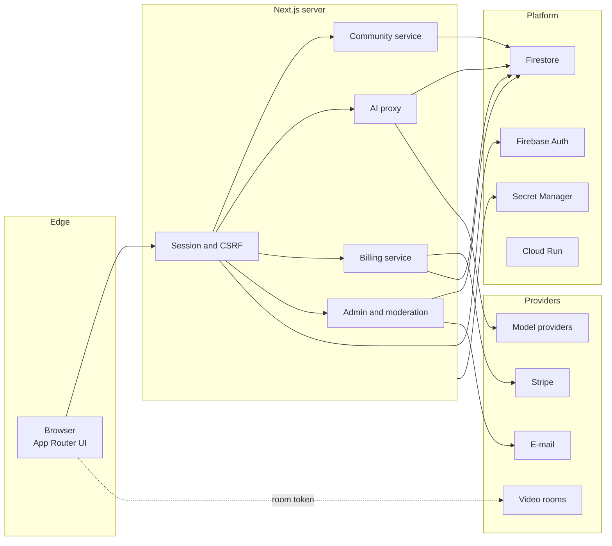

# Architecture

## 1. Context

Zoka is a multi-tenant study platform with three surfaces that share one identity and one billing model: public pages (marketing, blog, legal), authenticated communities (groups, channels, direct messages, focus rooms) and an AI tutor. It runs as a single Next.js application on Cloud Run, with Firebase for identity and persistence and Stripe for billing.

The architecture follows one rule: **the browser is never trusted with a decision that costs money, exposes another user's data, or changes entitlement.** Everything in this document follows from that.

## 2. Constraints

- **Audience includes minors.** Data minimisation, consent-gated telemetry and moderation are functional requirements.
- **AI cost is variable.** A request that reaches a model provider has a real marginal cost, so quotas must be enforced before the call, not after.
- **Managed infrastructure, small team.** The system is designed to be operated by one engineer, which rules out anything requiring a dedicated operations rotation.
- **Regional data.** Persistence and identity are pinned to a São Paulo region.
- **Three locales from day one.** Portuguese, English and Spanish, including legal pages and transactional e-mail.

## 3. Components

| Component | Responsibility | Boundary |
|---|---|---|
| Session layer | Exchanges a Firebase ID token for an HttpOnly session, validates CSRF, projects role and plan | Only place that reads credentials |
| Community service | Groups, membership, channels, messages, direct messages, read models | Never returns another tenant's rows |
| AI proxy | Intent classification, quota reservation and settlement, streaming, sanitisation | Only component that holds provider credentials |
| Billing service | Checkout sessions, webhook verification, entitlement resolution, vouchers | Only component that writes entitlement |
| Admin and moderation | Manual grants, alerts, revenue views, reports | Requires role claim and server-side re-check |
| Firestore | Durable state, rules closed by default | Rules are a second boundary, not the first |

## 4. Contracts and boundaries

**Session contract.** The client holds an opaque session cookie. The server resolves it to a user record, a role and a plan on every request. Route handlers receive an authorisation context, never a raw cookie.

**Community contract.** Every read and write takes an actor and a resource; the service resolves membership and role before touching persistence. Read models for channels are projections, rebuilt from events, so the UI never queries the primary collection directly.

**AI contract.** The proxy accepts a normalised request (messages, attachments, intent hints), returns a stream of typed events, and guarantees that a quota decision was made before the provider was called. Failures map to a small taxonomy: blocked content, rate limited, provider unavailable, unknown.

**Billing contract.** Entitlement is derived, never stored as a flag the client can influence. A webhook event is accepted only after signature verification, then deduplicated by event id, then applied idempotently.

## 5. Request flow: a tutor question

1. The browser posts to the Zoka API with the session cookie and a CSRF token.
2. The route handler resolves the session, checks membership and rate limits.
3. The proxy classifies intent. Only questions that require current information trigger a web search, and the search has its own daily quota.
4. A transaction reserves a tutoring slot for the day and registers the attempt in the hourly window.
5. The provider stream opens. If it fails before the first token, the reservation is rolled back and the client receives a retryable error with the draft preserved.
6. Deltas are proxied to the client as server-sent events, with a typed error event for policy blocks.
7. On completion, the reservation is settled and the message is persisted with its quota effect.

## 6. Data model (conceptual)

The model has five aggregates. **Identity** (user, credentials, role, plan, consent). **Community** (group, membership, channel, message, moderation record). **Conversation** (thread, message, attachment, quota reservation). **Commerce** (subscription, invoice reference, voucher, grant). **Operations** (alert, audit entry, report).

Relationships are ownership-based: a message belongs to a channel, a channel to a group, a membership to a group and a user. Cross-group reads are impossible by construction. Quota reservations are separate documents from messages so that a failed generation leaves an auditable record without a phantom message.

No schema, collection name or index definition is published here.

## 7. Deployment

One container image serves the application; Cloud Run provides the runtime, with secrets injected by reference from a managed store. Firestore and Auth are regional. Static assets are served from the hosting layer. Deployments are revisions, with traffic split used for controlled rollouts and rollback by revision, not by rebuild.

Background work (moderation batches, e-mail delivery, reconciliation) runs in the same runtime through scheduled and event-triggered handlers, which keeps operational surface small at the cost of sharing a process with request traffic.

## 8. Known limits

- Polling, not push, for message updates. Chosen for cost and simplicity; the trade-off is up to three seconds of latency.
- The AI proxy is a single point of failure for tutoring. It degrades to an error state with the draft preserved, not to a fallback model.
- Batching moderation means detection is not instantaneous.
- Firestore rules duplicate server authorization. That duplication is deliberate, and it must be kept in sync, which is a real maintenance cost.
