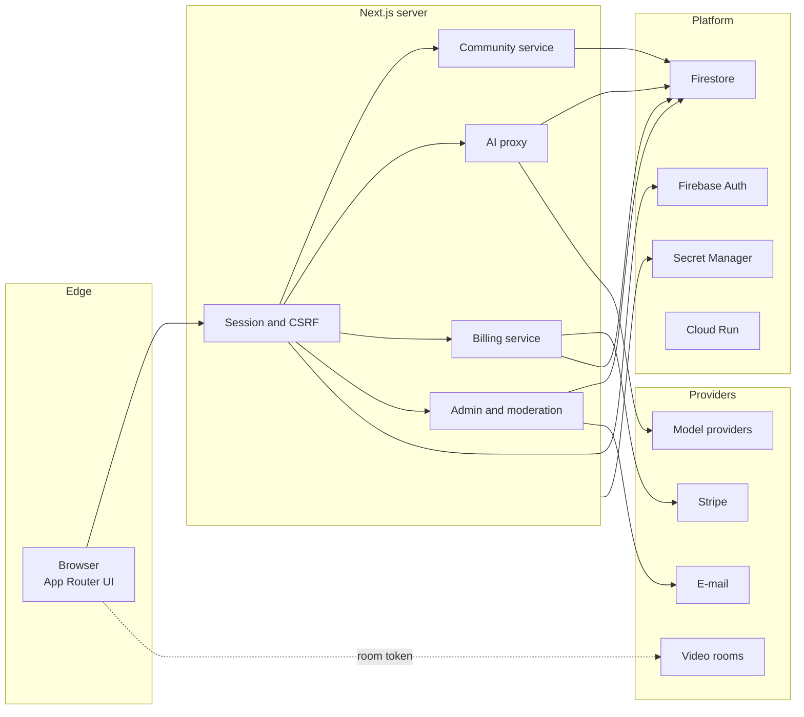

# Arquitetura

## 1. Contexto

Zoka é uma plataforma de estudos multi-tenant com três superfícies que compartilham uma identidade e um modelo de billing: páginas públicas (marketing, blog, jurídico), comunidades autenticadas (grupos, canais, mensagens diretas, salas de foco) e um tutor de IA. Roda como uma única aplicação Next.js no Cloud Run, com Firebase para identidade e persistência e Stripe para billing.

A arquitetura segue uma regra: **o browser nunca recebe confiança para decidir algo que custa dinheiro, expõe dados de outro usuário ou altera entitlement.** Tudo neste documento decorre disso.

## 2. Restrições

- **O público inclui menores.** Minimização de dados, telemetria condicionada a consentimento e moderação são requisitos funcionais.
- **O custo de IA é variável.** Uma requisição que chega a um provider de modelo tem custo marginal real, então as cotas precisam ser aplicadas antes da chamada, não depois.
- **Infraestrutura gerenciada, time pequeno.** O sistema foi desenhado para ser operado por um engenheiro, o que descarta qualquer coisa que exija um plantão de operações dedicado.
- **Dados regionais.** Persistência e identidade fixadas em uma região de São Paulo.
- **Três locales desde o primeiro dia.** Português, inglês e espanhol, incluindo páginas legais e e-mail transacional.

## 3. Componentes

| Componente | Responsabilidade | Fronteira |
|---|---|---|
| Camada de sessão | Troca um ID token do Firebase por uma sessão HttpOnly, valida CSRF, projeta papel e plano | Único lugar que lê credenciais |
| Serviço de comunidades | Grupos, associação, canais, mensagens, mensagens diretas, read models | Nunca retorna linhas de outro tenant |
| Proxy de IA | Classificação de intenção, reserva e liquidação de cota, streaming, sanitização | Único componente que guarda credenciais de provider |
| Serviço de billing | Sessões de checkout, verificação de webhook, resolução de entitlement, vouchers | Único componente que escreve entitlement |
| Administração e moderação | Concessões manuais, alertas, visões de receita, relatórios | Exige claim de papel e nova verificação no servidor |
| Firestore | Estado durável, rules fechadas por padrão | As rules são a segunda fronteira, não a primeira |

## 4. Contratos e fronteiras

**Contrato de sessão.** O cliente guarda um cookie de sessão opaco. O servidor o resolve para um registro de usuário, um papel e um plano em cada requisição. Os route handlers recebem um contexto de autorização, nunca um cookie bruto.

**Contrato de comunidade.** Toda leitura e escrita recebe um ator e um recurso; o serviço resolve associação e papel antes de tocar na persistência. Os read models dos canais são projeções, reconstruídas a partir de eventos, então a UI nunca consulta a coleção primária diretamente.

**Contrato de IA.** O proxy aceita uma requisição normalizada (mensagens, anexos, dicas de intenção), retorna um stream de eventos tipados e garante que uma decisão de cota foi tomada antes de o provider ser chamado. Falhas mapeiam para uma taxonomia pequena: conteúdo bloqueado, rate limited, provider indisponível, desconhecido.

**Contrato de billing.** O entitlement é derivado, nunca armazenado como uma flag que o cliente possa influenciar. Um evento de webhook só é aceito depois da verificação de assinatura, depois é deduplicado por id de evento e então aplicado de forma idempotente.

## 5. Fluxo de uma requisição: uma pergunta ao tutor

1. O browser faz um POST na API da Zoka com o cookie de sessão e um token CSRF.
2. O route handler resolve a sessão, verifica associação e rate limits.
3. O proxy classifica a intenção. Só perguntas que exigem informação atual disparam uma busca na web, e a busca tem cota diária própria.
4. Uma transação reserva uma vaga de tutoria para o dia e registra a tentativa na janela horária.
5. O stream do provider abre. Se falhar antes do primeiro token, a reserva é desfeita e o cliente recebe um erro que permite nova tentativa, com o rascunho preservado.
6. Os deltas são repassados ao cliente como server-sent events, com um evento de erro tipado para bloqueios de política.
7. Na conclusão, a reserva é liquidada e a mensagem é persistida com o seu efeito na cota.

## 6. Modelo de dados (conceitual)

O modelo tem cinco agregados. **Identidade** (usuário, credenciais, papel, plano, consentimento). **Comunidade** (grupo, associação, canal, mensagem, registro de moderação). **Conversa** (thread, mensagem, anexo, reserva de cota). **Comércio** (assinatura, referência de fatura, voucher, concessão). **Operações** (alerta, entrada de auditoria, relatório).

As relações são por posse: uma mensagem pertence a um canal, um canal a um grupo, uma associação a um grupo e a um usuário. Leituras entre grupos são impossíveis por construção. Reservas de cota são documentos separados das mensagens, para que uma geração que falha deixe um registro auditável sem uma mensagem fantasma.

Nenhum schema, nome de coleção ou definição de índice é publicado aqui.

## 7. Deploy

Uma imagem de container serve a aplicação; o Cloud Run fornece o runtime, com secrets injetados por referência a partir de um store gerenciado. Firestore e Auth são regionais. Assets estáticos são servidos pela camada de hosting. Deploys são revisões, com divisão de tráfego usada para rollouts controlados e rollback por revisão, não por rebuild.

Trabalho em background (lotes de moderação, envio de e-mail, reconciliação) roda no mesmo runtime por meio de handlers agendados e disparados por evento, o que mantém a superfície operacional pequena ao custo de compartilhar um processo com o tráfego de requisições.

## 8. Limites conhecidos

- Polling, não push, para atualizações de mensagens. Escolhido por custo e simplicidade; o trade-off é até três segundos de latência.
- O proxy de IA é um ponto único de falha para a tutoria. Ele degrada para um estado de erro com o rascunho preservado, não para um modelo de fallback.
- A moderação em lotes significa que a detecção não é instantânea.
- As rules do Firestore duplicam a autorização do servidor. Essa duplicação é deliberada e precisa ser mantida em sincronia, o que é um custo de manutenção real.
