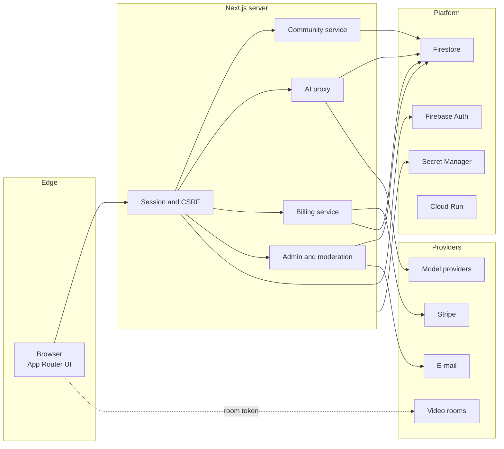

# Arquitetura

## 1. Contexto

Zoka é uma plataforma de estudos multi-tenant com três superfícies que compartilham a mesma identidade e o mesmo modelo de billing: páginas públicas (marketing, blog, jurídico), comunidades autenticadas (grupos, canais, mensagens diretas, salas de foco) e um tutor de IA. Tudo roda como uma única aplicação Next.js no Cloud Run, com Firebase para identidade e persistência e Stripe para billing.

A arquitetura segue uma regra só: **o browser nunca decide nada que custe dinheiro, exponha dados de outro usuário ou altere entitlement.** O resto deste documento sai dessa regra.

## 2. Restrições

- **O público inclui menores.** Minimizar dados, condicionar telemetria a consentimento e moderar conteúdo são requisitos funcionais.
- **O custo de IA varia.** Requisição que chega a um provider de modelo tem custo marginal real, então a cota precisa ser aplicada antes da chamada, não depois.
- **Infraestrutura gerenciada, time pequeno.** O sistema foi desenhado para que um engenheiro o opere sozinho, o que descarta qualquer coisa que exija plantão de operações dedicado.
- **Dados regionais.** Persistência e identidade presas a uma região de São Paulo.
- **Três locales desde o primeiro dia.** Português, inglês e espanhol, inclusive páginas legais e e-mail transacional.

## 3. Componentes

| Componente | Responsabilidade | Fronteira |
|---|---|---|
| Camada de sessão | Troca de ID token do Firebase por uma sessão HttpOnly, valida CSRF, projeta papel e plano | Único lugar que lê credenciais |
| Serviço de comunidades | Grupos, associação, canais, mensagens, mensagens diretas, read models | Nunca devolve linha de outro tenant |
| Proxy de IA | Classificação de intenção, reserva e liquidação de cota, streaming, sanitização | Único componente que guarda credencial de provider |
| Serviço de billing | Sessões de checkout, verificação de webhook, resolução de entitlement, vouchers | Único componente que escreve entitlement |
| Administração e moderação | Concessões manuais, alertas, visões de receita, relatórios | Exige claim de papel e nova checagem no servidor |
| Firestore | Estado durável, rules fechadas por padrão | As rules são a segunda fronteira, não a primeira |

## 4. Contratos e fronteiras

**Contrato de sessão.** O cliente carrega um cookie de sessão opaco. A cada requisição, o servidor transforma esse cookie em um registro de usuário, um papel e um plano. O route handler recebe um contexto de autorização, nunca o cookie cru.

**Contrato de comunidade.** Toda leitura e toda escrita recebem um ator e um recurso; o serviço resolve associação e papel antes de encostar na persistência. Os read models de canal são projeções reconstruídas a partir de eventos, e por isso a UI nunca consulta a coleção primária.

**Contrato de IA.** O proxy recebe uma requisição normalizada (mensagens, anexos, dicas de intenção) e devolve um stream de eventos tipados. Garante uma coisa: a decisão de cota aconteceu antes da chamada ao provider. Falha cai em uma taxonomia curta, com conteúdo bloqueado, rate limited, provider indisponível e desconhecido.

**Contrato de billing.** Entitlement é derivado, nunca guardado como flag que o cliente possa mexer. Evento de webhook só entra depois da verificação de assinatura, é deduplicado por id de evento e só então aplicado, com idempotência.

## 5. Fluxo de uma requisição: uma pergunta ao tutor

1. O browser faz POST na API da Zoka com o cookie de sessão e o token CSRF.
2. O route handler resolve a sessão e confere associação e rate limits.
3. O proxy classifica a intenção. Só pergunta que precisa de informação atual dispara busca na web, e a busca tem cota diária própria.
4. Uma transação reserva a vaga de tutoria do dia e registra a tentativa na janela horária.
5. O stream do provider abre. Se ele falhar antes do primeiro token, a reserva é desfeita e o cliente recebe um erro que permite nova tentativa, com o rascunho preservado.
6. Os deltas seguem para o cliente como server-sent events, com um evento de erro tipado para bloqueio de política.
7. No fim, a reserva é liquidada e a mensagem é gravada junto com o efeito na cota.

## 6. Modelo de dados (conceitual)

O modelo tem cinco agregados. **Identidade** (usuário, credenciais, papel, plano, consentimento). **Comunidade** (grupo, associação, canal, mensagem, registro de moderação). **Conversa** (thread, mensagem, anexo, reserva de cota). **Comércio** (assinatura, referência de fatura, voucher, concessão). **Operações** (alerta, entrada de auditoria, relatório).

As relações são de posse: a mensagem pertence ao canal, o canal ao grupo, a associação ao grupo e ao usuário. Ler entre grupos é impossível por construção. A reserva de cota é um documento separado da mensagem, e assim uma geração que falha deixa registro auditável sem mensagem fantasma.

Nenhum schema, nome de coleção ou definição de índice aparece aqui.

## 7. Deploy

Uma imagem de container serve a aplicação. O Cloud Run entrega o runtime, com secrets injetados por referência a partir de um store gerenciado. Firestore e Auth são regionais. Assets estáticos saem da camada de hosting. Cada deploy é uma revisão: divisão de tráfego para rollout controlado e rollback por revisão, sem rebuild.

Trabalho em background (lotes de moderação, envio de e-mail, reconciliação) roda no mesmo runtime, em handlers agendados e disparados por evento. A superfície operacional fica pequena, ao custo de dividir processo com o tráfego de requisições.

## 8. Limites conhecidos

- Polling, não push, para atualização de mensagem. A escolha foi por custo e simplicidade; o preço é até três segundos de latência.
- O proxy de IA é ponto único de falha da tutoria. Ele cai para um estado de erro com o rascunho preservado, não para um modelo de fallback.
- Moderação em lote significa detecção não instantânea.
- As rules do Firestore repetem a autorização do servidor. A duplicação é deliberada e precisa ficar em sincronia, o que custa manutenção de verdade.
